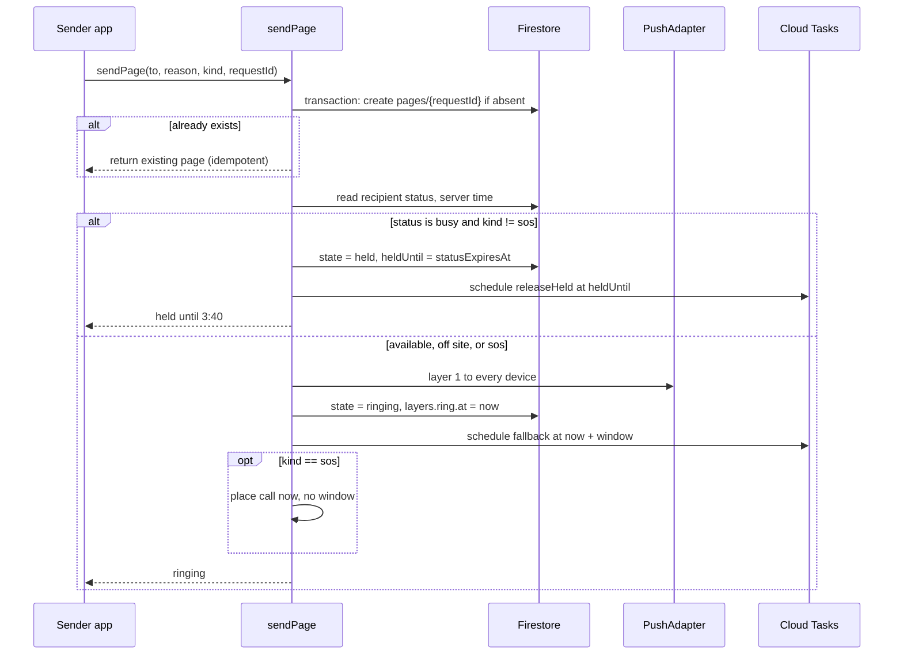
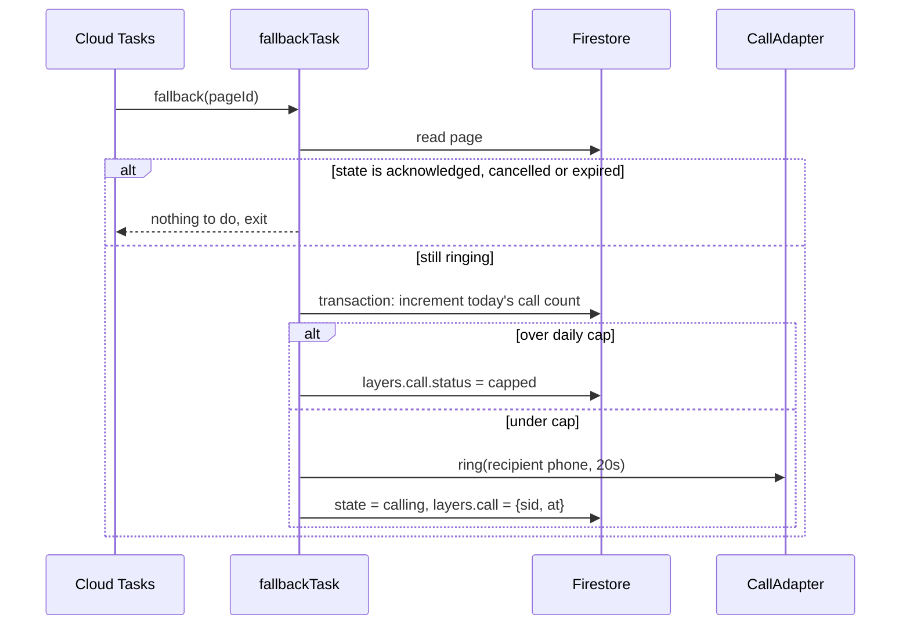
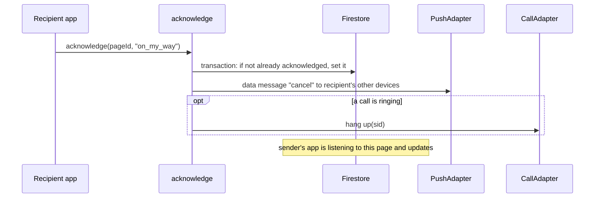
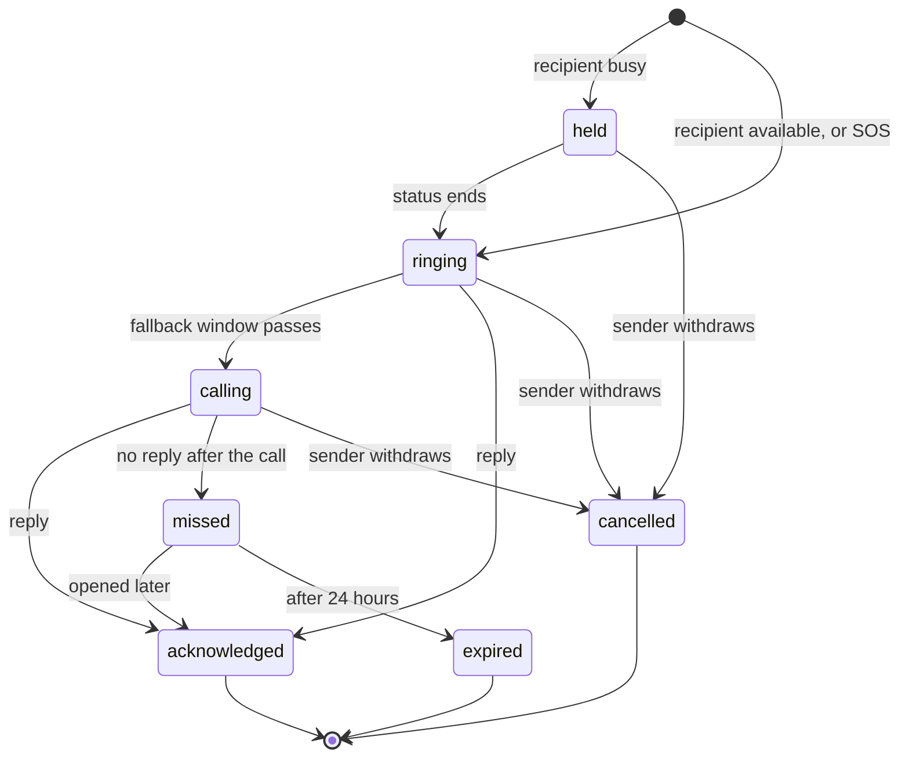

# Architecture

How the system is put together, and why. Read [How it works](02-how-it-works.md) first; this document assumes you know the two-layer model.

Sequence and state diagrams use Mermaid and render on GitHub, GitLab and most markdown viewers. The system diagram is plain text.

## System overview

```
 ┌───────────────────────┐          ┌───────────────────────┐
 │   Flutter app         │          │   Flutter app         │
 │   (sender)            │          │   (recipient)         │
 └──────────┬────────────┘          └──────────▲────────────┘
            │ callable: sendPage                │ push (FCM/APNs)
            │ callable: acknowledge             │ call (PSTN)
            ▼                                   │
 ┌──────────────────────────────────────────────┴────────────┐
 │                    Cloud Functions                         │
 │                                                            │
 │   sendPage ──► DeliveryEngine ──► PushAdapter  ──► FCM     │
 │                     │                                      │
 │                     ├──► schedules fallback (Cloud Tasks)  │
 │                     │                                      │
 │   fallbackTask ─────┴──► CallAdapter ──► Twilio / AT       │
 │                                                            │
 │   releaseHeld (Cloud Tasks)     acknowledge                │
 └──────────────────────────┬─────────────────────────────────┘
                            │
                     ┌──────▼──────┐
                     │  Firestore  │   people · devices · pages · config
                     └─────────────┘
```

| Component | Job | Technology |
|---|---|---|
| Mobile app | Directory, sending, receiving, status, setup | Flutter, Riverpod |
| Send and acknowledge endpoints | Validate, decide, deliver | Cloud Functions (2nd gen), callable |
| Delivery engine | Layer 1 now, schedule layer 2, respect status | Plain TypeScript module |
| Scheduler | Fallback calls, releasing held pages | Cloud Tasks |
| Push | Layer 1 on both platforms | FCM (APNs underneath for iPhone) |
| Telephony | Layer 2 | Twilio for the demo, Africa's Talking in production |
| Data | Everything persistent | Firestore |

Cloud Functions need Firebase's pay-as-you-go plan, which needs a card on the account. The free allowance covers this workload easily, but the card has to be there. Sort it out before you need to deploy.

## The delivery engine

This is the part that matters. Everything else is ordinary app work.

### Sending



### The fallback



The fallback task never needs to be deleted when someone replies. It runs, reads the page, sees the reply, and exits. That's simpler and safer than trying to cancel tasks, which can race.

### Acknowledging



### Choosing the fallback window

One person can have several devices. The window is the shortest among them, because the fallback call goes to one phone number regardless.

```
window = min over devices of:
    iPhone, criticalAlertsGranted = false  →  config.fallbackSeconds.ios      (10)
    iPhone, criticalAlertsGranted = true   →  config.fallbackSeconds.android  (30)
    Android                                →  config.fallbackSeconds.android  (30)

kind == sos  →  0, and the call fires alongside layer 1
```

All values live in one Firestore document, so they can be tuned without deploying code.

```json
// config/delivery
{
  "fallbackSeconds": { "ios": 10, "android": 30 },
  "criticalAlertsGranted": false,
  "ringSeconds": 20,
  "dailyCallCap": 200,
  "ringTtlSeconds": 60
}
```

## Adapters

Delivery goes through two small interfaces so providers can change without touching the engine. The switch from Twilio to Africa's Talking is already planned, so this seam pays for itself within weeks.

```ts
interface PushAdapter {
  ring(device: Device, page: Page): Promise<PushResult>;
  cancel(device: Device, pageId: string): Promise<void>;
}

interface CallAdapter {
  ring(phone: string, page: Page, seconds: number): Promise<{ sid: string }>;
  hangUp(sid: string): Promise<void>;
}
```

| Adapter | Implementation |
|---|---|
| `FcmPushAdapter` | Builds the platform payloads described below |
| `TwilioCallAdapter` | Demo and first weeks |
| `AfricasTalkingCallAdapter` | Production, Kenyan caller ID |
| `FakeCallAdapter` | Tests and local development. Records calls, never dials. |

### Push payloads

Android and iPhone need different payloads, and getting this wrong is the most common way the feature ends up silent.

**Android.** Send a `notification` block that names the alarm channel the app created at startup. When the app is killed, Android posts the notification itself, and the channel supplies the alarm sound. A data-only message depends on the app's background handler starting up, and battery managers on many Android phones delay or block that. For the ring, always use a `notification` block.

```ts
android: {
  priority: 'high',
  ttl: 60_000,
  notification: {
    channelId: kind === 'sos' ? 'hodi_sos_v1' : 'hodi_page_v1',
    notificationPriority: 'PRIORITY_MAX',
    visibility: 'PUBLIC',
  },
}
```

**iPhone.** A Time Sensitive alert with sound, and `mutable-content` so the notification service extension can report delivery.

```ts
apns: {
  headers: { 'apns-priority': '10', 'apns-push-type': 'alert' },
  payload: {
    aps: {
      sound: criticalAlertsGranted
        ? { critical: 1, name: 'hodi_page.caf', volume: 1.0 }
        : 'hodi_page.caf',
      'interruption-level': criticalAlertsGranted ? 'critical' : 'time-sensitive',
      'mutable-content': 1,
    },
  },
}
```

**Cancel messages** are data-only on both platforms. They must never make a sound.

## Data model

Everything sits under `orgs/{orgId}` from day one. There's only one organisation today, but moving data under an organisation later means migrating every document and rewriting every security rule. Doing it now costs one path segment.

```
orgs/{orgId}
  name, codeHash, timezone, workingHours

orgs/{orgId}/people/{personId}
  name, role, photoUrl, active
  status: 'available' | 'meeting' | 'driving' | 'focused' | 'offsite'
  statusExpiresAt          // server timestamp, never client-written
  lastVerifiedAt           // last passed reachability check
  prefersVisualAlert       // accessibility setting

orgs/{orgId}/people/{personId}/private/contact
  phone                    // E.164. Server-only. Never readable by clients.

orgs/{orgId}/people/{personId}/devices/{deviceId}
  platform: 'android' | 'ios'
  pushToken, model, osVersion, appVersion
  lastSeenAt, stale

orgs/{orgId}/pages/{pageId}          // pageId = client requestId
  fromId, toId, reason
  kind: 'page' | 'sos' | 'test'
  seq                      // int, used as the local notification id
  state: 'held' | 'ringing' | 'calling' | 'acknowledged'
       | 'missed' | 'cancelled' | 'expired'
  createdAt, heldUntil
  layers: {
    ring: { at, deviceCount },
    call: { at, sid, status, costKes }
  }
  response: 'on_my_way' | 'five_minutes' | 'busy'
  respondedAt

orgs/{orgId}/counters/pageSeq        // { next: int }
orgs/{orgId}/spend/{yyyy-mm-dd}      // { calls: int }
config/delivery                      // see above
```

### Notes on the model

The phone number lives in a separate document that no client can read. That enforces NFR-12 in the database rather than trusting every screen to hide it.

`statusExpiresAt` is written by the server using `FieldValue.serverTimestamp()` plus the chosen duration. A phone's clock can be wrong by minutes, and a client-written expiry would reintroduce the exact bug that server-side checking prevents.

`seq` exists because local notifications on a phone need an integer id. Using a hash of the page id risks two pages getting the same number, and then replying to one dismisses the other. A counter allocated in the send transaction can't collide.

`layers` is the analytics backbone. The share of pages that needed the call, and how long replies take, both come straight from it.

The pages collection keyed by the client's request id is what makes sending idempotent. If the app retries after a timeout, the transaction finds the existing page and returns it. Nobody gets rung twice.

## Page states



Only the server changes state, always inside a transaction, and only along these arrows.

## Security rules

A sketch of the intent. The real rules need tests (see [Testing](09-testing.md)).

```
match /orgs/{orgId} {
  function member() {
    return request.auth != null
      && request.auth.token.orgId == orgId;
  }

  match /people/{personId} {
    allow read: if member();
    // People may update only their own display fields.
    // Status goes through a function so the server sets expiry.
    allow update: if member()
      && request.auth.uid == personId
      && request.resource.data.diff(resource.data).affectedKeys()
           .hasOnly(['name', 'role', 'photoUrl', 'prefersVisualAlert']);

    match /private/{doc} { allow read, write: if false; }

    match /devices/{deviceId} {
      allow read, write: if member() && request.auth.uid == personId;
    }
  }

  match /pages/{pageId} {
    allow read: if member() && (
      resource.data.fromId == request.auth.uid ||
      resource.data.toId == request.auth.uid ||
      resource.data.kind == 'sos'
    );
    allow write: if false;   // functions only
  }

  match /counters/{d} { allow read, write: if false; }
  match /spend/{d}    { allow read, write: if false; }
}
```

The organisation code gives someone a custom `orgId` claim through a join function. Anyone with the code can join, which is acceptable at 25 people who all know each other. Rotate the code if it leaks, and add an approval step before the roster grows much.

## Scaling

The design holds to a few hundred people without changes.

| Pressure point | At 25 people | At 300 people | What to do then |
|---|---|---|---|
| `counters/pageSeq` writes | A few a day | Maybe one a minute | Nothing. Firestore handles one write a second per document. |
| `spend/{date}` writes | A handful a day | Dozens a day | Nothing. |
| Directory size | One scroll | Needs search | Add departments and search (already in the model). |
| Page volume | Tens a day | Hundreds a day | Nothing. |
| Abuse | Visible logs are enough | Needs limits | Per-sender rate limit in `sendPage`. |

Nothing here needs sharding until well past the first thousand users.

## Failure modes

| What breaks | Effect | How we handle it |
|---|---|---|
| FCM or APNs slow or down | Layer 1 late or missing | Fallback call still fires after the window |
| Telephony provider down | No layer 2 | Layer 1 still rings. Sender is told the call failed and offered a normal call. |
| Daily call cap reached | No layer 2 | Same as above, and an alert goes to the administrator |
| Push token expired | Device never rings | FCM returns "unregistered". Mark the device stale, prompt the person on next open. |
| Cloud Tasks delayed | Fallback late | Tasks are usually on time to the second. Monitor the gap between scheduled and actual. |
| Firestore down | Nothing works | Accepted at this size. Google's uptime is better than anything we'd run. |
| Android battery manager kills the app | Layer 1 may not arrive | Layer 2 after 30 seconds, plus setup instructions per make |
| Emergency Bypass reverts on an iPhone | Fallback call silent | The 30-day reachability check catches it |

Everything depends on one Firebase project and one phone number. That's a single point of failure and it's accepted at this size. Write it down, move on, revisit before a second organisation.

## What's deliberately missing

No offline queue for sending, beyond one automatic retry. A page that can't send right now should say so, because someone who needs a colleague urgently will walk if the app can't help.

No web client. No custom authentication beyond the organisation code. No analytics service; the page log answers every question we currently have.

Each of these is a real feature and each can wait until someone needs it.
